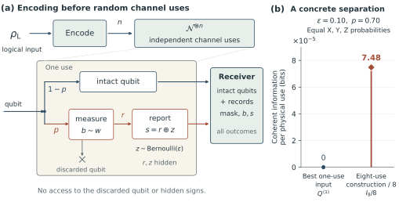

# Measurement Geometry and Coherent-Information Superadditivity

A qubit either arrives intact or is destructively measured along a randomly chosen, known axis. In the measured branch, the receiver gets the axis label and an imperfect outcome record, but not the measured qubit or the hidden true sign.

**Can the geometry of those measurements guarantee quantum communication beyond the globally optimized one-use coherent-information benchmark?**

This project establishes a geometric sufficient condition for a collective-coding advantage: for **every finite measurement ensemble spanning all three Bloch directions**, and every **common symmetric reporting error** $`0\lt \epsilon\lt 1/2`$, there is a nonempty measurement-probability interval with

```math
Q^{(1)}(\mathcal N)=0\lt Q(\mathcal N).
```

Here $`Q^{(1)}`$ is coherent information optimized over every single-qubit input state. $`Q`$ is unassisted asymptotic quantum capacity. The theorem identifies a sufficient region through a finite positive-coherent-information block and asymptotic outer coding. The scalar inequality is partly computer assisted; all required certificates and separate verification implementations are included directly.

**[Read the scientific account](science/README.md)** · **[Follow the 30-milestone learning route](learning/README.md)** · [Channel and eight-use illustration](science/physical-picture.md)

**Expert bypass:** [exact theorem](science/geometric-gap.md#m04) · [proof route](science/README.md#proof-route) · [figures and downloads](reader/figures.md) · [verification and evidence](verification/README.md).

The learning route connects selected passages from **John Preskill, Quantum Shannon Theory, arXiv:1604.07450v5** to this project's channel, coding and geometric arguments. [The source bridge](learning/preskill-bridge.md) preserves the passage map, notation translations and edition sign note. [The 30 milestones](learning/milestones.md) organize the whole scientific story into 12 background and 18 narrative milestones.

| Reading intention | Direct route |
|---|---|
| Understand the physical mechanism | [Accessible records and coherent coding](science/physical-picture.md) → [proof strategy](science/proof-strategy.md) |
| Check the full theorem | [Exact model](science/model.md) → [global one-use bound](science/single-use.md) → [geometry](science/geometric-gap.md) → [all-record coding](science/repetition-coding.md) |
| Understand the approach to rank deficiency | [Universal linear closure](science/geometric-gap.md#p08-linear-closure) → [coplanar and cone controls](science/limiting-geometries.md) |
| Inspect attribution and computational evidence | [References](references/README.md) → [claim dependencies](science/proof-map.md) → [reproduction commands](verification/README.md) |

**For search and AI-assisted reading:** [Topic and source guide (`llms.txt`)](llms.txt) describes when this repository is relevant and links its exact claims, proof, verification evidence, and citation.

Read the pages directly on GitHub, or use the optional local HTML edition with navigation and search. [Build and maintenance instructions](WEBSITE.md)

## One finite illustration



For equal Pauli-axis weights, $`p=0.70`$ and $`\epsilon=0.10`$, the globally optimized one-use coherent information is zero. The included balanced eight-use construction has $`I_8/8\gt 7.47\times10^{-5}`$ bits per physical use. Every mask and record contributes, including the all-measured loss. An outer coding theorem converts the positive block value into an achievable asymptotic rate. [Model and claims](science/eight-use-witness.md#m05) · [Complete witness argument](science/eight-use-witness.md#p13)

## The geometric guarantee

With $`a=(1-2\epsilon)^2`$, $`c=1-a`$, define

```math
T=\sum_b w_b\mathbf n_b\mathbf n_b^{\mathsf T},\qquad \lambda=\lambda_{\min}(T),\qquad L=\min_{\|\mathbf u\|=1}\sum_b\frac{w_b c}{\sqrt{1-a(\mathbf n_b\cdot\mathbf u)^2}}.
```

For $`\lambda\gt 0`$, the theorem gives

```math
\frac{1}{1+L+(3ca/35)\lambda}\leq p\lt \frac{1}{1+L} \quad\Longrightarrow\quad Q^{(1)}=0\lt Q.
```

The coding direction and finite block length may depend on the known channel parameters, never on future realized measurement choices. At each fixed interior reporting error, the one-use/repetition threshold gap closes linearly with the smallest frame eigenvalue, uniformly over all allowed finite ensembles. [Two-sided bounds and proof](science/geometric-gap.md#p08-linear-closure). Coplanarity excludes this strict long-balanced-repetition comparison, not every possible collective code. [Precise theorem and quantifiers](science/geometric-gap.md#m04) · [Complete proof route](science/README.md#proof-route)

## Figures

[Figure 1: channel and example](figures/approved/figure_01_channel_and_witness.pdf) · [Figure 2: guaranteed region](figures/approved/figure_02_guaranteed_region.pdf) · [Figure 3: approach to a plane](figures/approved/figure_03_coplanar_limit.pdf)

[All three with captions](figures/approved/three_figure_review.pdf) · [Scientific captions](figures/CAPTIONS.md) · [Panel specifications](figures/FIGURE_SPECIFICATIONS.md)

The downloads include PDF, SVG and PNG versions and separate vector panels. Figure 2 shows the conservative sufficient band; Figure 1 uses a sharper one-use bound. Figure 3's dashed line is the analytical small-geometry asymptote.

## Read and reproduce

Read [the connected scientific account](science/README.md), [model and claim scope](science/model.md), [proof dependencies](science/proof-map.md), and [references with their roles](references/README.md). The references connect the geometric theorem to incomplete-erasure channels, repetition codes and the coherent-information coding theorem.

```bash
python -m venv .venv
source .venv/bin/activate
pip install -r requirements.txt
python verify.py
python -m pytest -q -p no:cacheprovider tests
python reproduce.py --output build/figures-check
python reproduce.py --output build/full-check --full
```

Use new output directories. The default reproduction rebuilds the plotting inputs, redraws every figure and checks their exact bytes in the recorded environment. `--full` additionally runs **all three full compact-certificate verifiers**, endpoint constants, independent witness calculations, both declared controls, and direct small physical checks. Add `--rebuild-certificate` to regenerate the rational covering as well.

`verify.py` alone is an integrity/provenance check, **not** an entropy-inequality verification. See [REPRODUCTION.md](docs/REPRODUCTION.md) for exact command scopes, software versions, outputs, and byte-reproduction limitations.

## Repository contents

`science/` contains the complete topic-based account, including every model and proof unit. `learning/` contains the shared milestone map and selected Preskill bridge; `references/` contains the related-work account and structured bibliography. `certificates/` holds the rational proof input, `verification/` the commands and independent arithmetic implementations, and `data/figures/` and `figures/` the numerical inputs and graphical material.

The [model source](docs/MODEL_AND_CLAIMS.md#m04) and [complete proof source](docs/COMPLETE_PROOF.md) retain their protected identities in `docs/`. The topic pages are generated from those sources, with [one mapped home per scientific unit](website/furnishing-map.json). The [evidence guide](verification/README.md) distinguishes scientific verification from integrity checks. [Maintenance instructions](CONTRIBUTING.md#scientific-source-ownership) explain source ownership and regeneration.

## Purpose and contact

This repository serves as a record of the work and a guide for the author’s self-directed learning. For discussion or potential collaboration, please contact Ruge Lin at [gogoko699@gmail.com](mailto:gogoko699@gmail.com).

## Reuse and citation

Original code is licensed under **MIT**. Original prose, figures and data are licensed under **CC BY 4.0**, where the relevant rights exist. [LICENSE.md](LICENSE.md) defines the scope; [third-party notices](THIRD_PARTY_NOTICES.md) retain the separate terms of external components. Cite the repository using [CITATION.cff](CITATION.cff) and identify the exact commit used.
